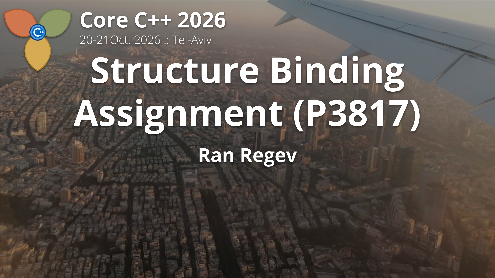

<!-- The title slide — what sits on screen in the hall before the talk starts.

     One line of content, and that is the point: everything that makes this
     look like a cover rather than a document is in assets/cover.css, and the
     keyboard is in assets/cover.js. Both are injected at build time by
     render.sh, exactly as the decks take slides/assets/slide.css and .js.

     The image is a real link, so a click advances to the paper even with JS
     off; the script only adds the ?y= hand-back that returns the paper to
     the line it was on.

     Built to dist/index.html. Not a deck — a title slide must not carry deck
     chrome (the slide counter, a "back to the paper" link), and its forward
     action is "advance to the paper", which is not what slide.js does. -->

{.cover}
